<p align="center">
  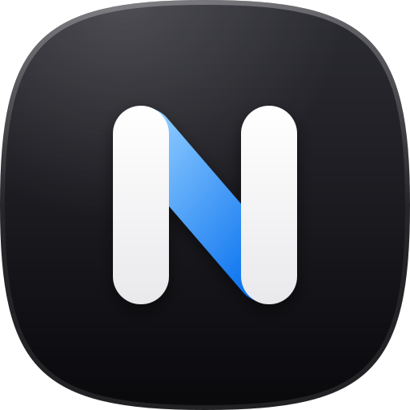
</p>

<h1 align="center">Nimbstia</h1>

<p align="center">
  <b>A calm, keyboard-first workbench for macOS.</b><br>
  Clipboard history, Lightshot-style screenshots, window layouts, a project opener and a status hub —<br>
  one Hammerspoon config, native on Apple Silicon, private by default.
</p>

<p align="center">
  
  
  
  
  <a href="README.tr.md"></a>
</p>

<p align="center">
  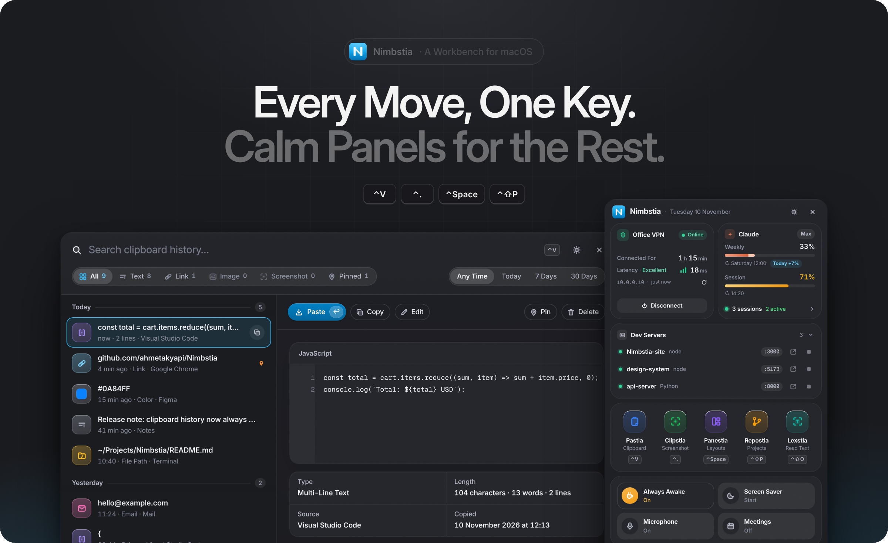
</p>

<p align="center">
  <a href="#install">Install</a> ·
  <a href="#with-an-ai-agent-easiest">Install With AI</a> ·
  <a href="#the-tools">Tools</a> ·
  <a href="#all-shortcuts">Shortcuts</a> ·
  <a href="#configure">Configure</a> ·
  <a href="#privacy">Privacy</a>
</p>

---

**Why.** A few everyday moves cost too many clicks on macOS: finding what you copied an hour ago, putting two windows side by side, grabbing a marked-up screenshot, jumping into the right repository. Nimbstia turns each one into a single shortcut and a panel that gets out of your way.

- **Native and light** — plain Lua and small HTML panels inside [Hammerspoon](https://www.hammerspoon.org). No Electron, idle CPU ~0 %, memory stays flat (≈ 140 MB after ten screenshots).
- **Private by default** — everything stays on your Mac. Password-manager copies are never recorded.
- **Calm by design** — one shared design system (`theme.css`): bright neutral surfaces, colour only where it means something, Inter bundled offline, real light and dark themes with a one-click switch, only the hints you need.

> The interface is Turkish by default (the author's daily language) and fully English with `language = "en"` in `config.local.lua`. One small layer, [`i18n.js`](i18n.js), translates every panel; adding a language is one table — PRs welcome.

## Nimbstia — the hub

Click the mark in the menu bar. Everything about your day sits in one popover: whether the VPN and your dev host are reachable, how much of your Claude plan is left and which Claude Code sessions are running, every tool one click away, and the quick switches you reach for most.

<p align="center">
  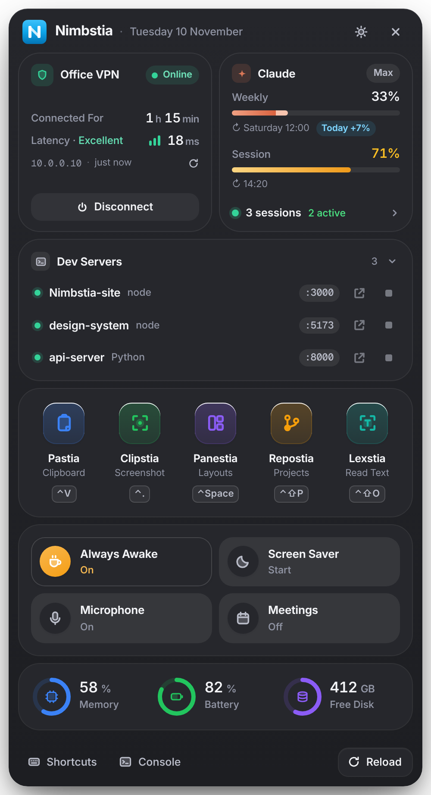
</p>

- **Connection** — VPN + TCP check to your host every 30 s and right after wake or a network change; a live green chip with the latency when all is well.
- **Claude usage** — weekly and session limits as bar meters, reset time and open sessions (opens the session on claude.ai), read from the files Claude Code keeps locally.
- **Dev servers** — every local server that is listening right now (`npm run dev`, Vite, Django, Ollama…) with its port and project folder; open it in the browser or stop it in one click. Handy when coding agents leave servers running.
- **Quick switches** — keep the Mac awake <kbd>Ctrl</kbd> <kbd>Opt</kbd> <kbd>K</kbd>, mute the microphone <kbd>Ctrl</kbd> <kbd>Opt</kbd> <kbd>M</kbd>, a screen saver that keeps the Mac awake (Claude sessions and the browser keep working behind it; styled like the lock screen, it fades out on any key or a deliberate mouse move, not a nudge), and opt-in meeting alerts from macOS Calendar.
- **System** — CPU and memory (tap either for the apps using it), battery and free disk at a glance.

## The tools

### Pastia · clipboard history — <kbd>Ctrl</kbd> <kbd>V</kbd>

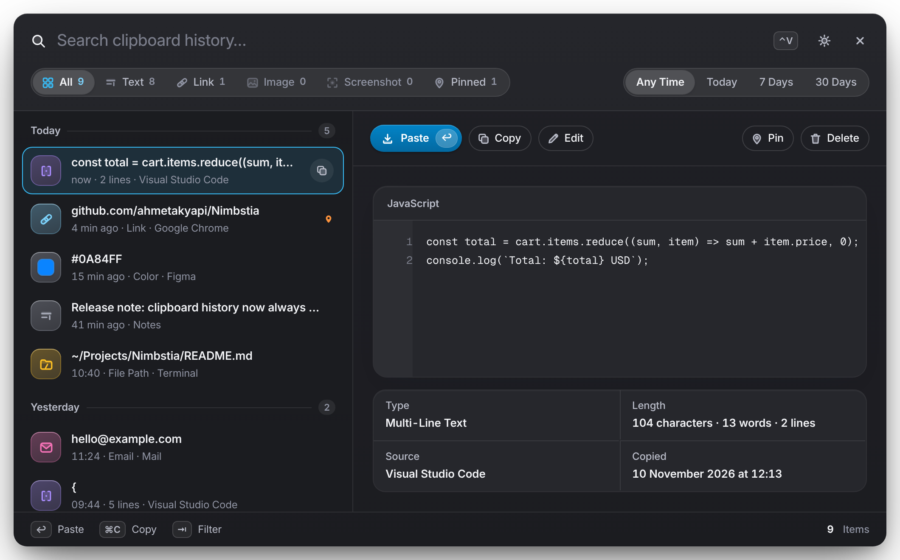

Text, links, colours, copied images and your screenshots folder — always newest first, grouped by day. Filter by kind and time, search, pin, edit in place, copy without closing (<kbd>Cmd</kbd> <kbd>C</kbd>) or paste (<kbd>↩</kbd>). Screenshots you have not pinned move to the Trash after 30 days.

### Clipstia · screenshots — <kbd>Cmd</kbd> <kbd>.</kbd>

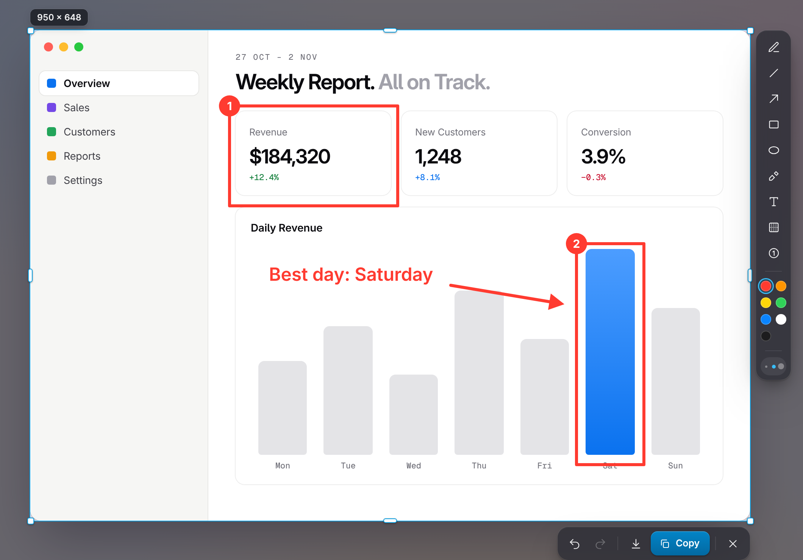

Freezes the screen — even with a menu open — then you drag the region and mark it up: pen, line, arrow, box, ellipse, marker, text, blur, numbered steps. <kbd>Ctrl</kbd> <kbd>C</kbd> saves **and** copies, <kbd>Cmd</kbd> <kbd>S</kbd> only saves.

### Panestia · window layouts — <kbd>Ctrl</kbd> <kbd>Space</kbd>

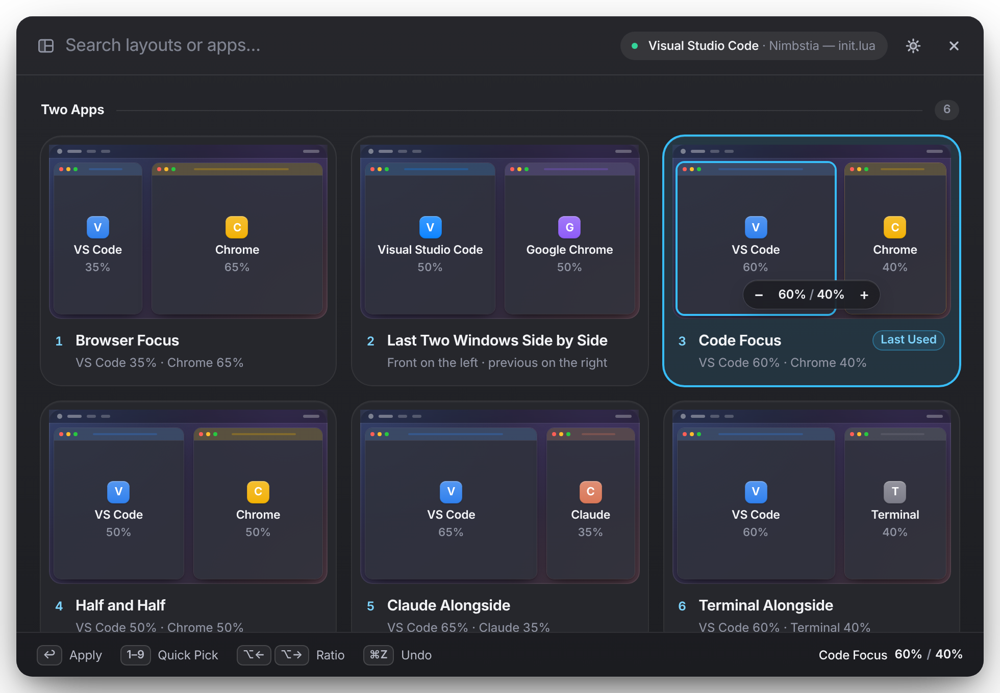

Multi-app layouts in one key, "last two windows side by side", adjustable splits and undo. Snap the focused window with <kbd>Ctrl</kbd> <kbd>Opt</kbd> + arrows — press again for ⅓ → ⅔.

### Repostia · projects — <kbd>Ctrl</kbd> <kbd>Shift</kbd> <kbd>P</kbd>

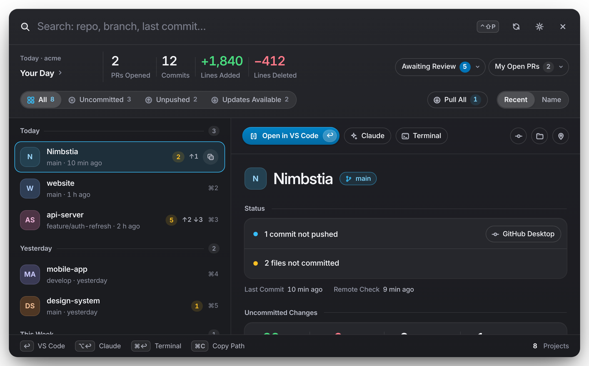

Every repository in `~/Projects` with branch, changes, ahead/behind and recent commits. Opens in VS Code, Terminal, Claude Code, GitHub Desktop or Finder. The strip on top counts your commits, PRs and lines added / deleted for today, this week or this month, with a bar per day; click its title for the last 90 days of commits, day by day, filtered by repo or search.

### And the small ones

| Tool | Shortcut | What it does |
|---|---|---|
| **Lexstia** · text from screen | <kbd>Ctrl</kbd> <kbd>Shift</kbd> <kbd>O</kbd> | Select an area; its text (Turkish + English) lands on the clipboard. |
| **Twistia** · transform text | <kbd>Ctrl</kbd> <kbd>Opt</kbd> <kbd>T</kbd> | JSON pretty/minify, JWT decode, Base64, URL, timestamps ↔ dates, case, sort/unique lines, SQL `IN` list, UUID — replaces the selection. |
| **Snipstia** · snippets | `;key` · <kbd>Ctrl</kbd> <kbd>Opt</kbd> <kbd>S</kbd> | Type `;tarih`, `;daily`, `;pr`… and it expands. Edit them in `snippets.lua`. |
| **Hopstia** · app keys | <kbd>Ctrl</kbd> <kbd>Opt</kbd> <kbd>Cmd</kbd> + letter | V VS Code · C Chrome · A Claude · T Teams · X Terminal · O Outlook · W WhatsApp · G GitHub Desktop · F Finder. Press again to cycle windows. |
| **Jira** | <kbd>Ctrl</kbd> <kbd>Opt</kbd> <kbd>J</kbd> | Opens the issue key found in the selection or clipboard (`ABC-123`). |

<div align="center">
<details>
<summary><b>Light theme</b>: every panel also comes in light, one click on the sun/moon button</summary>
<br>
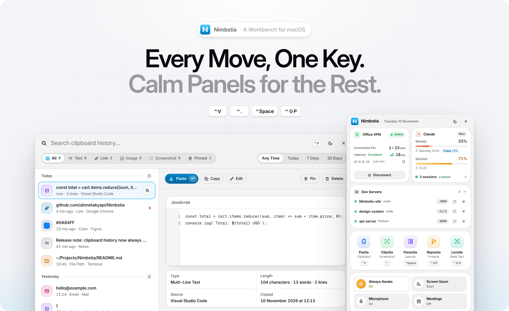<br><br>
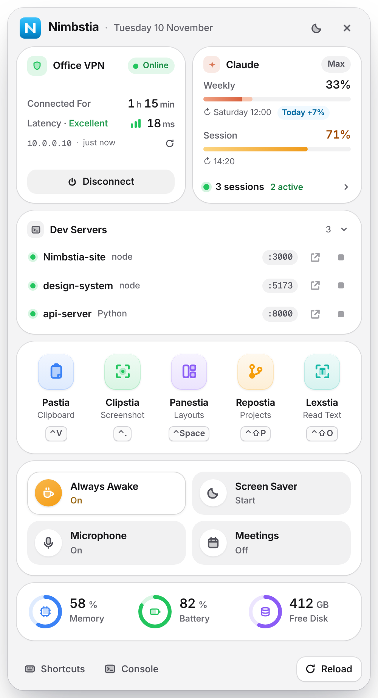<br><br>
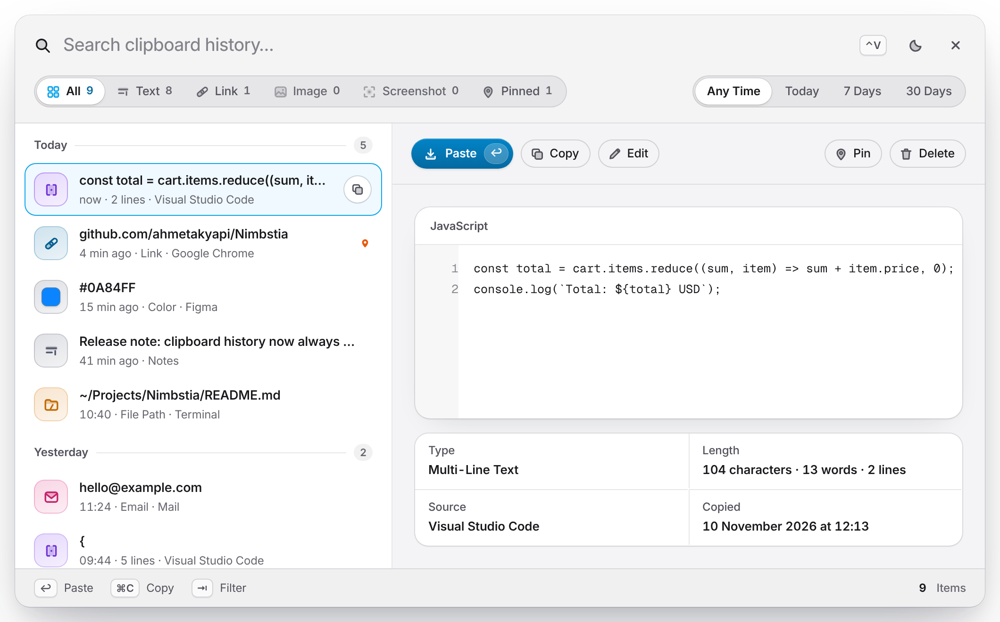<br><br>
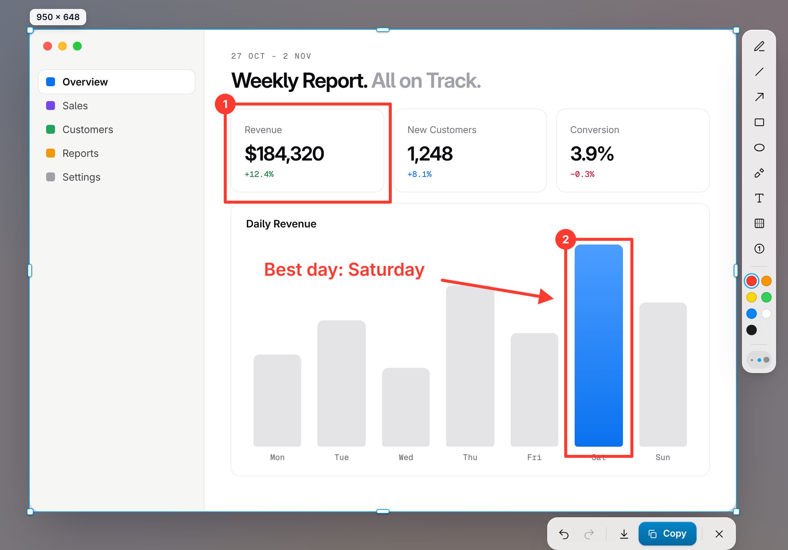<br><br>
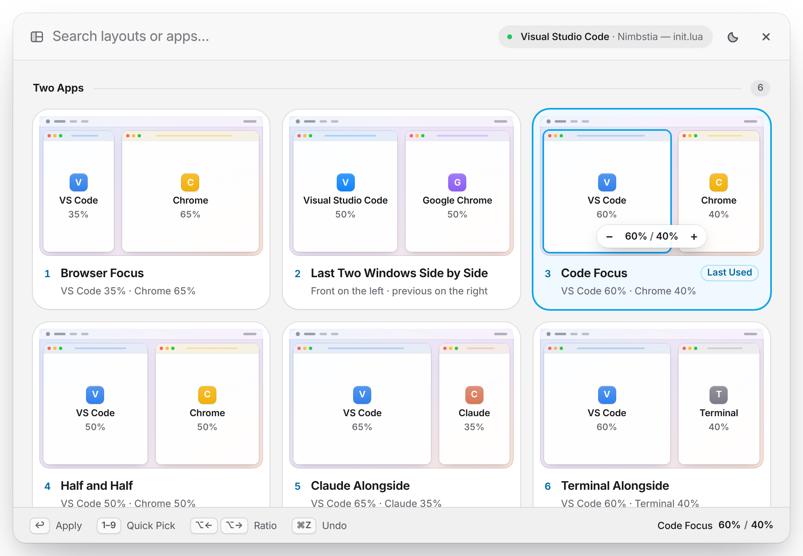<br><br>
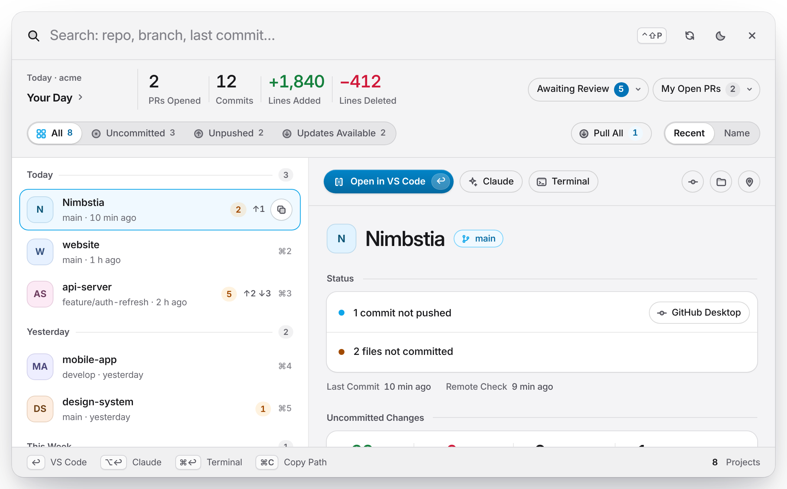<br><br>
</details>
</div>

## All shortcuts

| Keys | Action | Keys | Action |
|---|---|---|---|
| <kbd>Ctrl</kbd> <kbd>V</kbd> | Pastia | <kbd>Ctrl</kbd> <kbd>Opt</kbd> <kbd>←</kbd> <kbd>→</kbd> | Snap left / right (again: ⅓ · ⅔) |
| <kbd>Cmd</kbd> <kbd>.</kbd> | Clipstia | <kbd>Ctrl</kbd> <kbd>Opt</kbd> <kbd>↑</kbd> <kbd>↓</kbd> <kbd>↩</kbd> | Top / bottom / full |
| <kbd>Ctrl</kbd> <kbd>Space</kbd> | Panestia | <kbd>Ctrl</kbd> <kbd>Opt</kbd> <kbd>C</kbd> · <kbd>Z</kbd> | Centre · undo placement |
| <kbd>Ctrl</kbd> <kbd>Shift</kbd> <kbd>P</kbd> | Repostia | <kbd>Ctrl</kbd> <kbd>Opt</kbd> <kbd>Cmd</kbd> <kbd>←</kbd> <kbd>→</kbd> | Move to the other display |
| <kbd>Ctrl</kbd> <kbd>Shift</kbd> <kbd>O</kbd> | Lexstia | <kbd>Ctrl</kbd> <kbd>Opt</kbd> <kbd>K</kbd> | Keep awake |
| <kbd>Ctrl</kbd> <kbd>Opt</kbd> <kbd>T</kbd> | Twistia | <kbd>Ctrl</kbd> <kbd>Opt</kbd> <kbd>M</kbd> | Microphone mute |
| <kbd>Ctrl</kbd> <kbd>Opt</kbd> <kbd>S</kbd> | Snipstia | <kbd>Cmd</kbd> <kbd>L</kbd> / <kbd>Ctrl</kbd> <kbd>Cmd</kbd> <kbd>L</kbd> | Lock screen |

## Install

### With an AI agent (easiest)

Paste this into Claude Code, Codex, Cursor or any coding agent that can run shell commands:

```text
Install Nimbstia on this Mac by following https://github.com/ahmetakyapi/Nimbstia/blob/main/AGENTS.md
step by step. Ask me before backing up my current Hammerspoon config and before filling in any
personal settings, then walk me through the macOS permissions and verify that everything loaded.
```

[`AGENTS.md`](AGENTS.md) is a short runbook written for agents: prerequisite checks, the installer, which
optional settings to ask you about, the two permissions you switch on yourself, a verification step and
fixes for common problems.

### With one command

```bash
curl -fsSL https://raw.githubusercontent.com/ahmetakyapi/Nimbstia/main/install.sh | bash
```

The script installs Hammerspoon with Homebrew if it is missing, backs up an existing `~/.hammerspoon` (to `~/.hammerspoon.backup-<date>`), clones Nimbstia there and starts it. Prefer to look first? Clone it yourself:

```bash
git clone https://github.com/ahmetakyapi/Nimbstia.git ~/.hammerspoon
cp ~/.hammerspoon/config.example.lua ~/.hammerspoon/config.local.lua
open -a Hammerspoon
```

It also builds **Nimbstia.app** in Applications — keep it in the Dock and one click opens the hub (`scripts/build-app.sh` rebuilds it).

Then give Hammerspoon two permissions in **System Settings › Privacy & Security**: **Accessibility** (hotkeys, windows, snippets) and **Screen Recording** (screenshots, text recognition). Nimbstia starts with your Mac.

## Configure

Personal values live in `config.local.lua` (git-ignored). Every key is optional — features that need a missing value hide themselves.

```lua
return {
  jiraBase = "https://your-company.atlassian.net/browse/",          -- Ctrl Opt J
  jiraProjects = { "ABC", "OPS" },                                    -- only these key prefixes
  devCheck = { name = "DEV", host = "10.0.0.10", port = 22 },          -- connection card
  language = "en",                                                    -- interface language ("tr" by default)
  screenshotDir = os.getenv("HOME") .. "/Documents/Screenshots",
  batteryClamshell = true,                                            -- closed lid + external display on battery
}
```

- **Snippets:** `snippets.lua` — a plain list of `{ key, label, text }`; `text` may be a function (dates).
- **Layouts and app keys:** the tables at the top of `layouts.lua` and `tools.lua`.
- **Closed lid on battery:** macOS keeps a closed MacBook driving an external display only on AC power. With `batteryClamshell = true`, Nimbstia disables sleep while an external display is connected and restores it the moment the display is unplugged (or Hammerspoon quits), so the Mac still sleeps in a bag. Run `scripts/clamshell-setup.sh` once: it installs a sudoers rule that allows only `pmset disablesleep 0|1` (`--uninstall` removes it).
- **Theme:** the sun/moon button in the header of every panel and of the hub.
- **Shortcut clashes:** <kbd>Ctrl</kbd> <kbd>V</kbd> replaces Vim's visual-block key and <kbd>Ctrl</kbd> <kbd>Space</kbd> replaces macOS "previous input source". Change the bindings in `init.lua` if you rely on them.

## Privacy

- Clipboard history is stored locally in Hammerspoon's settings; copied images and thumbnails in `clipdata/` (git-ignored).
- Items marked by password managers (`org.nspasteboard.ConcealedType`, 1Password, Bitwarden, KeePassXC…) are never stored, and the tools that briefly borrow the clipboard restore it without re-publishing secrets.
- Claude usage and sessions are read from the files Claude Code keeps on your Mac (`~/.claude.json`, `~/.claude/sessions`); nothing is sent anywhere.
- The dev servers card reads listening ports locally with `lsof`; the stop button only signals a process the hub listed itself.
- The only network traffic is the optional TCP check to the host you configure. Meeting alerts read the macOS Calendar locally and only after you turn them on.

## Project layout

```
init.lua            entry point: loads every module safely and binds the global shortcuts
config.lua          defaults + config.local.lua override
panel.lua           shared floating webview panel (focus, theme switch, inlines theme.css + i18n.js + motion.js)
i18n.js             English interface (language = "en"): one DOM translation table for every panel
theme.css           design system shared by every panel: tokens, Inter type, keycaps, motion system
motion.js           motion helpers shared by every panel: gliding selection, sliding thumb, count-up, keycap feedback
ui.lua              shared style for toasts and pickers
keep.lua            keeps fire-and-forget timers/tasks alive until they finish
pb.lua              pasteboard helpers: secret detection, safe save/restore
status.lua          Nimbstia hub: menu bar icon + status popover (pulstia.html)
claude.lua          Claude plan usage and open Claude Code sessions (read-only)
clipboard.lua/.html Pastia: clipboard history
shot.lua/.html      Clipstia: screenshot overlay and annotation editor
layouts.lua/.html   Panestia: window layouts
projects.lua/.html  Repostia: project opener (+ bin/projects-scan.py)
tools.lua           Hopstia app keys, Lexstia OCR, Twistia transforms, Snipstia snippets, Jira
bin/                small helpers (OCR and Calendar via JavaScript for Automation, transforms)
scripts/            maintenance (README screenshots and hero image, demo data only)
scripts/preview/    browser preview of every panel with demo data (no Mac needed)
assets/fonts/       Inter + Geist Mono (SIL Open Font License)
AGENTS.md           install runbook for AI coding agents
```

## Design and previews

Every panel links one stylesheet, [`theme.css`](theme.css): colour tokens for light and dark, Inter for everything you read
and Geist Mono for code, hashes and hosts (bundled in `assets/fonts`, never fetched), keycaps and the motion curves. `panel.lua` inlines it, fonts included, so the panels stay fully offline.

To work on the UI without a Mac, open the panels in a browser with demo data:

```bash
npm i -D playwright && npx playwright install chromium   # once
node scripts/preview/shoot.js out clipboard pulstia      # out/<panel>-light.png and -dark.png
node scripts/preview/shoot.js --readme                   # regenerate every README image
```

## Uninstall

Quit Hammerspoon, delete `~/.hammerspoon` (or restore your backup) and, if you like, Hammerspoon itself.

## License

[MIT](LICENSE) © Ahmet Akyapı
