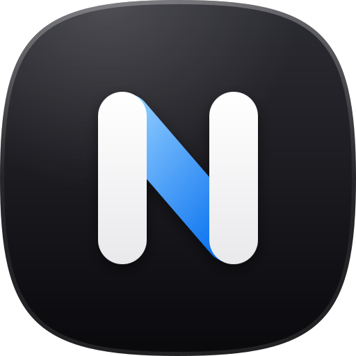
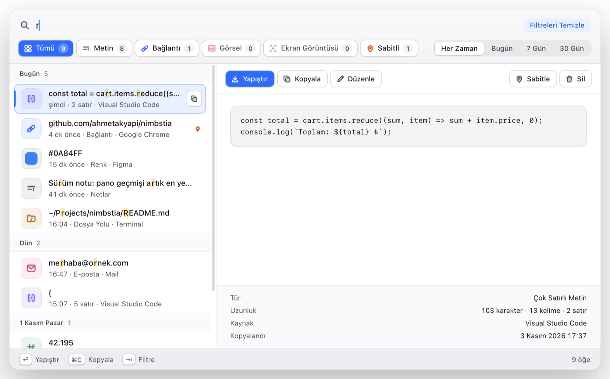
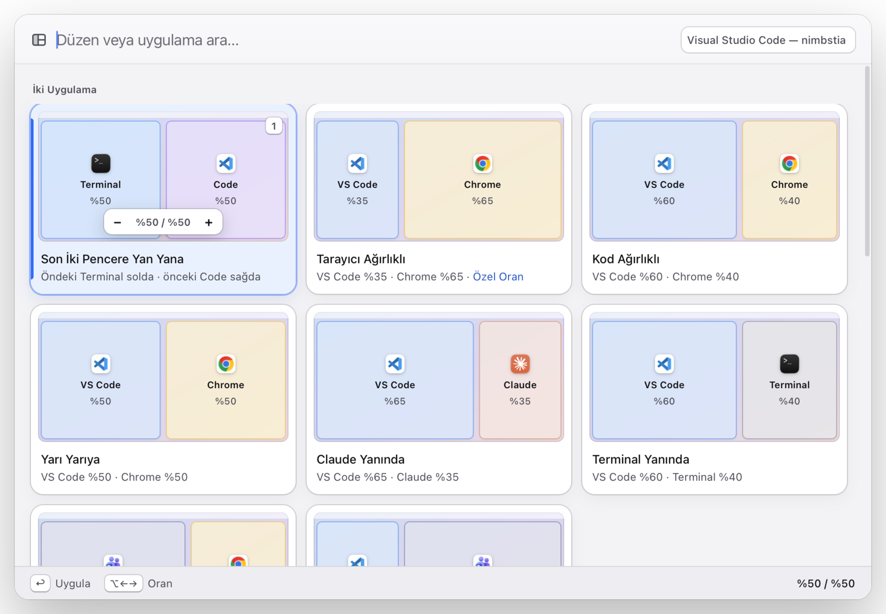
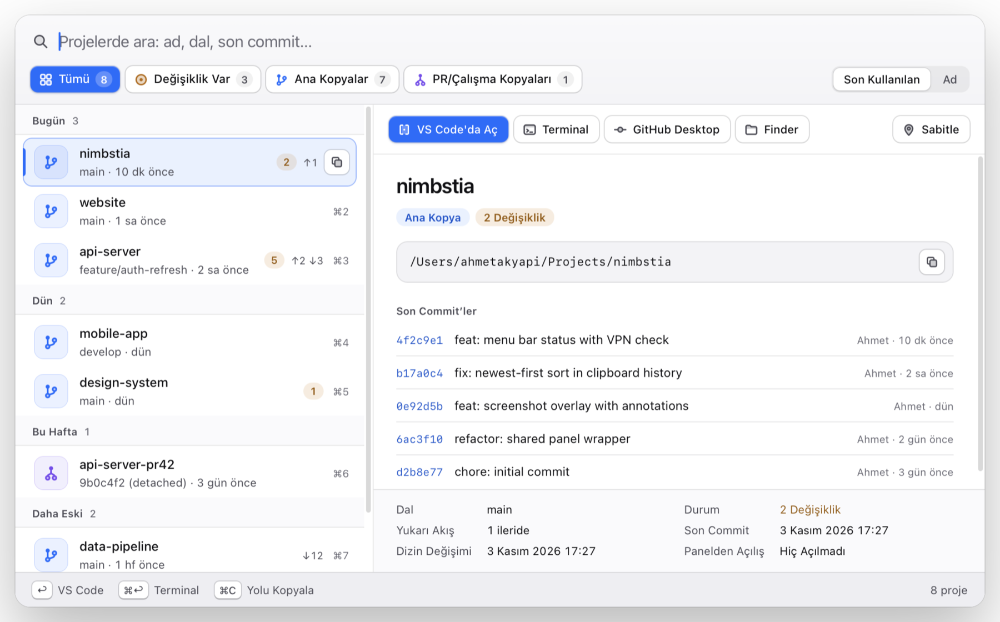
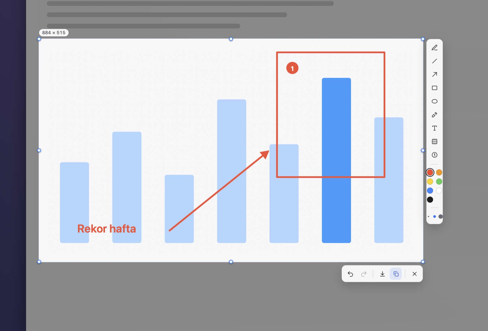
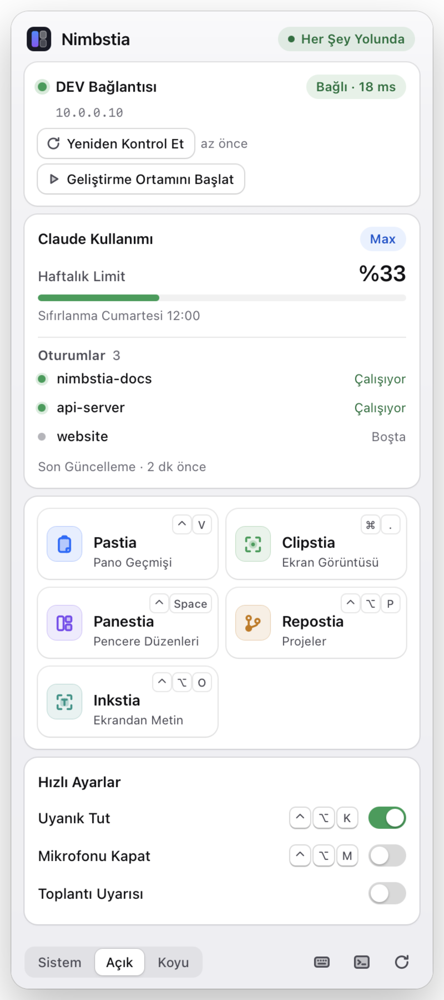

<p align="center">
  
</p>

<h1 align="center">Nimbstia</h1>

<p align="center">
  macOS için klavye öncelikli bir çalışma tezgâhı: pano geçmişi, pencere düzenleri, Lightshot tarzı ekran görüntüsü,<br>
  proje açıcı ve sakin bir durum panosu. Tek bir Hammerspoon yapılandırması, Apple Silicon'da yerel çalışır.
</p>

<p align="center">
  <a href="README.md">English</a>
</p>

<p align="center">
  <picture>
    <source media="(prefers-color-scheme: dark)" srcset="assets/screens/clipboard-dark.png">
    
  </picture>
</p>

## Neden

macOS'ta bazı gündelik işler gereğinden fazla tıklama istiyor: bir saat önce kopyaladığın şeyi bulmak, iki pencereyi yan yana koymak, üstüne not düşülmüş bir ekran görüntüsü almak, doğru depoyu açmak. Nimbstia bunların her birini tek kısayola ve yolunu kesmeyen bir panele indiriyor.

- **Yerel ve hafif.** Electron yok, ayrı bir uygulama yok: [Hammerspoon](https://www.hammerspoon.org) içinde çalışan Lua ve küçük HTML panelleri. Boştayken işlemci kullanımı ~%0.
- **Varsayılan olarak gizli.** Her şey senin Mac'inde kalır. Ayarladığın isteğe bağlı VPN/sunucu denetimi dışında ağ trafiği yok. Parola yöneticisinden kopyalananlar hiç kaydedilmez.
- **Sakin arayüz.** Tek vurgu rengi, gerçek açık ve koyu tema, yalnız gereken ipuçları, her şey klavyeden.

## Özellikler

| | Kısayol | Ne yapar |
|---|---|---|
| **Pastia** · pano | <kbd>⌃</kbd> <kbd>V</kbd> | Metin, bağlantı, renk, kopyalanan görseller ve ekran görüntüleri klasörü; en yeni üstte, günlere göre gruplu. Tür ve zaman filtreleri, arama, sabitleme, düzenleme; panel kapanmadan kopyalama (<kbd>⌘</kbd> <kbd>C</kbd>), yapıştırma (<kbd>↩</kbd>). |
| **Clipstia** · ekran görüntüsü | <kbd>⌘</kbd> <kbd>.</kbd> | Ekranı dondurur. Alanı sürükle ya da pencereye tıkla; kalem, çizgi, ok, kutu, elips, işaretleyici, metin, bulanıklaştırma, numaralı adımlar. <kbd>⌃</kbd> <kbd>C</kbd> / <kbd>⌘</kbd> <kbd>C</kbd> / <kbd>↩</kbd> kaydeder **ve** kopyalar, <kbd>⌘</kbd> <kbd>S</kbd> yalnız kaydeder. |
| **Panestia** · düzenler | <kbd>⌃</kbd> <kbd>Space</kbd> | Tek tuşla çok uygulamalı düzenler, "son iki pencere yan yana", ayarlanabilir oran, geri alma. |
| **Yaslama** | <kbd>⌃</kbd> <kbd>⌥</kbd> <kbd>←</kbd> <kbd>→</kbd> | Yarım ekran; tekrar bas: ⅓ → ⅔. <kbd>↑</kbd> <kbd>↓</kbd> üst/alt, <kbd>↩</kbd> tam, <kbd>C</kbd> ortala, <kbd>Z</kbd> geri al, <kbd>⌘</kbd> + oklar: diğer ekran. |
| **Repostia** · projeler | <kbd>⌃</kbd> <kbd>⌥</kbd> <kbd>P</kbd> | `~/Projects` altındaki her depo: dal, değişiklik sayısı, ileride/geride, son commit'ler. VS Code, Terminal, GitHub Desktop ya da Finder'da açar. |
| **Inkstia** · ekrandan metin | <kbd>⌃</kbd> <kbd>⌥</kbd> <kbd>O</kbd> | Bir alan seç, içindeki yazı (Türkçe + İngilizce) panoya gelir. |
| **Twistia** · dönüştürücü | <kbd>⌃</kbd> <kbd>⌥</kbd> <kbd>T</kbd> | JSON biçimlendir/sıkıştır, JWT çöz, Base64, URL, zaman damgası ↔ tarih, harf dönüşümleri, satır sırala/tekilleştir, SQL `IN` listesi, UUID… Seçimin yerine yazar. |
| **Snipstia** · şablonlar | `;anahtar` · <kbd>⌃</kbd> <kbd>⌥</kbd> <kbd>S</kbd> | `;tarih`, `;daily`, `;pr` yaz, metne dönüşsün. `snippets.lua` içinden düzenlenir. |
| **Hopstia** · uygulama geçişi | <kbd>⌃</kbd> <kbd>⌥</kbd> <kbd>⌘</kbd> + harf | V VS Code · C Chrome · A Claude · T Teams · X Terminal · O Outlook · W WhatsApp · G GitHub Desktop · F Finder. Tekrar basınca pencereleri arasında gezer. |
| **Pulstia** · durum panosu | menü çubuğu simgesi | VPN + sunucu erişimi (her şey yolundaysa yeşil nokta), Claude kullanım limiti ve açık oturumlar, uyanık tut (<kbd>⌃</kbd> <kbd>⌥</kbd> <kbd>K</kbd>), mikrofonu kapat (<kbd>⌃</kbd> <kbd>⌥</kbd> <kbd>M</kbd>), isteğe bağlı toplantı uyarısı, tema, tüm kısayollar. |
| **Jira** | <kbd>⌃</kbd> <kbd>⌥</kbd> <kbd>J</kbd> | Seçimdeki ya da panodaki iş anahtarını (`ABC-123`) açar. |

<table>
  <tr>
    <td width="50%">
      <picture>
        <source media="(prefers-color-scheme: dark)" srcset="assets/screens/layouts-dark.png">
        
      </picture>
    </td>
    <td width="50%">
      <picture>
        <source media="(prefers-color-scheme: dark)" srcset="assets/screens/projects-dark.png">
        
      </picture>
    </td>
  </tr>
  <tr>
    <td width="50%" align="center">
      <picture>
        <source media="(prefers-color-scheme: dark)" srcset="assets/screens/screenshot-dark.png">
        
      </picture>
    </td>
    <td width="50%" align="center">
      <picture>
        <source media="(prefers-color-scheme: dark)" srcset="assets/screens/popover-dark.png">
        
      </picture>
    </td>
  </tr>
</table>

## Kurulum

```bash
curl -fsSL https://raw.githubusercontent.com/ahmetakyapi/nimbstia/main/install.sh | bash
```

Betik, Hammerspoon yoksa Homebrew ile kurar, mevcut `~/.hammerspoon` klasörünü `~/.hammerspoon.backup-<tarih>` olarak yedekler, Nimbstia'ı oraya klonlar ve başlatır. Önce kendin bakmak istersen:

```bash
git clone https://github.com/ahmetakyapi/nimbstia.git ~/.hammerspoon
cp ~/.hammerspoon/config.example.lua ~/.hammerspoon/config.local.lua
open -a Hammerspoon
```

Ardından **Sistem Ayarları › Gizlilik ve Güvenlik** altında Hammerspoon'a iki izin ver:

- **Erişilebilirlik:** kısayollar, pencere taşıma, şablonlar.
- **Ekran Kaydı:** ekran görüntüsü aracı ve metin tanıma.

Nimbstia Mac açılınca kendiliğinden başlar. Menü çubuğundaki Nimbstia işaretine tıklayınca durum panosu açılır; geri kalan her şey bir kısayol uzağında.

## Ayarlar

Kişisel değerler `config.local.lua` dosyasında durur (git'e girmez). Hepsi isteğe bağlıdır; değeri olmayan özellik kendini gizler.

```lua
return {
  jiraBase = "https://sirketin.atlassian.net/browse/",              -- ⌃⌥J
  devCheck = { name = "DEV", host = "10.0.0.10", port = 22 },          -- panodaki bağlantı kartı
  launcher = { title = "Geliştirme ortamını başlat", path = os.getenv("HOME") .. "/Desktop/start.command" },
  screenshotDir = os.getenv("HOME") .. "/Documents/Screenshots",
}
```

- **Şablonlar:** `snippets.lua`, düz bir `{ key, label, text }` listesi; `text` bir fonksiyon da olabilir (tarihler için).
- **Düzenler ve uygulamalar:** `layouts.lua` ve `tools.lua` dosyalarının başındaki tablolar.
- **Tema:** panonun altındaki seçici (sistem, açık, koyu).
- **Kısayol çakışmaları:** <kbd>⌃</kbd> <kbd>V</kbd> Vim'in blok seçim tuşunun, <kbd>⌃</kbd> <kbd>Space</kbd> macOS'un "önceki giriş kaynağı" kısayolunun yerini alır (Sistem Ayarları › Klavye › Klavye Kısayolları › Giriş Kaynakları). Bunlara ihtiyacın varsa `init.lua` içindeki atamaları değiştir.
- **Jira önekleri:** yalnız kendi projelerinin anahtarları eşleşsin diye `jiraProjects = { "ABC", "OPS" }` ekle.

## Gizlilik

- Pano geçmişi Hammerspoon ayarlarında, kopyalanan görseller ve küçük resimler `clipdata/` klasöründe yerel olarak durur (git'e girmez).
- Parola yöneticilerinin işaretlediği kopyalar (`org.nspasteboard.ConcealedType`, 1Password…) hiç kaydedilmez.
- Claude kullanımı ve oturumlar, Claude Code'un Mac'inde tuttuğu dosyalardan okunur (`~/.claude.json`, `~/.claude/sessions`); hiçbir yere gönderilmez.
- Tek ağ trafiği, ayarladığın sunucuya yapılan isteğe bağlı TCP denetimidir. Toplantı uyarısı macOS Takvim'i yerelde ve yalnız sen açtıktan sonra okur.

## Kaldırma

Hammerspoon'dan çık, `~/.hammerspoon` klasörünü sil (ya da yedeğini geri koy) ve istersen Hammerspoon'u da kaldır.

## Lisans

[MIT](LICENSE) © Ahmet Akyapı
